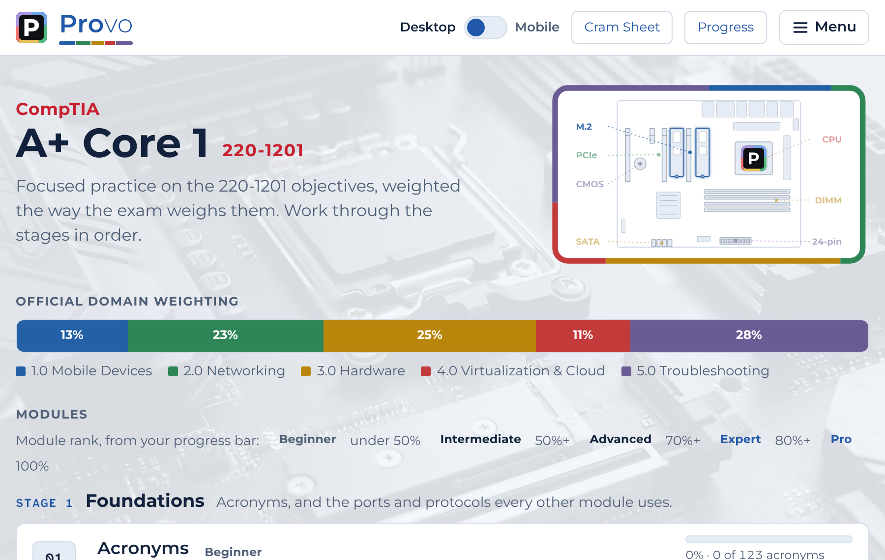

# Provo A+ Core 1

Provo's study lab for the **CompTIA A+ Core 1 (220-1201)** exam. It drills every exam domain, tracks what you have mastered, and finishes with timed mini-exams weighted to the official domains.

**Current release:** [v1.0.3](https://github.com/benmhsmith/Provo/releases/tag/a-plus-core-1-v1.0.3) · [All A+ Core 1 releases](https://github.com/benmhsmith/Provo/releases?q=a-plus-core-1) · [What changed](CHANGELOG.md)

A+ certification takes two exams. This tool covers **Core 1 (220-1201)**. [Core 2 (220-1202)](../a-plus-core-2/) has its own tool.

All 14 modules are open:

- **01 Acronyms:** 123 exam acronyms, asked three ways (spell it out, match the description, what it is), plus a Type it mode.
- **02 Ports & Protocols:** all 15 ports on the 220-1201 list, asked both ways (name to number and number to name) with spaced repetition, plus a reference with TCP and UDP and the secure and insecure pairs.
- **03 to 10, the objective modules:** 231 terms in 33 topics. Each term is asked several ways: name it, define it, and spot it in a scenario, with close neighbors (Cat 5e, Cat 6, and Cat 6a; the RAID levels; the cloud models) offered against each other. The two troubleshooting modules ask for each problem's usual fix, from its name and from a scenario.
- **11 Question Qualifiers:** 50 bench-tech questions, 10 each for FIRST, NEXT, BEST, MOST likely, and MINIMUM, with the A+ reading of each qualifier (safety and data first, smallest option that meets every requirement).
- **12 Exam-Style Drill:** 189 exam-style questions across all five domains and 27 skills. One question in four in modules 02 to 10 comes from this bank.
- **13 Performance-Based Questions:** seven simulations, a new variation every run: a help desk queue, two custom builds, a hardware monitor, power protection, printer service, a RAID array, and cabling and powering an access point.
- **14 Mini-Exams:** 212 questions in the pool (the exam-style bank plus 23 qualifier questions), picked in proportion to the domain weights, with PBQs first. Choose 10, 20, or 40 questions, or every PBQ back to back.

Use it in your browser: https://benmhsmith.github.io/Provo/a-plus-core-1/

<p></p>

## Exam at a glance

- Up to 90 questions in 90 minutes. Multiple choice (single and multiple response), drag and drop, and performance-based questions.
- Passing score: 675 on a 100–900 scale.
- Launched March 25, 2025 (A+ V15).

| Domain | Weight |
|---|---|
| 1.0 Mobile Devices | 13% |
| 2.0 Networking | 23% |
| 3.0 Hardware | 25% |
| 4.0 Virtualization and Cloud Computing | 11% |
| 5.0 Hardware and Network Troubleshooting | 28% |

## Modules

14 modules, weighted toward the heaviest domains: troubleshooting (28%), hardware (25%), and networking (23%).

| Stage | Module | Objectives |
|---|---|---|
| 1 · Foundations | 01 Acronyms | Acronyms |
| | 02 Ports & Protocols | 2.1 |
| 2 · Hardware & mobile devices | 03 Cables, Displays & Power | 3.1, 3.2, 3.6 |
| | 04 Motherboards, RAM & Storage | 3.3–3.5 |
| | 05 Printers & Multifunction Devices | 3.7–3.8 |
| | 06 Mobile Devices | 1.1–1.3 |
| 3 · Networking & cloud | 07 Networking | 2.2–2.8 |
| | 08 Virtualization & Cloud | 4.1–4.2 |
| 4 · Troubleshooting | 09 Troubleshoot Hardware, Displays & Mobile | 5.1–5.4 |
| | 10 Troubleshoot Networks & Printers | 5.5–5.6 |
| 5 · Exam skills | 11 Question Qualifiers | All |
| | 12 Exam-Style Drill | All |
| | 13 Performance-Based Questions | All |
| 6 · Test | 14 Mini-Exams | All |

## Exam-style questions

Every question is original and written to the 220-1201 objectives. Each one tests a skill the exam asks you to demonstrate, in one of four styles:

- **Best fit** (about half): plain-English scenarios where several answers fit part of the question and one fits best, with BEST, MOST likely, and FIRST used the way the exam uses them.
- **Scenario**: a short bench or help desk situation with one right action.
- **Exhibit**: read a battery report, ipconfig or ping output, a SMART readout, firmware settings, a RAID controller screen, or a printer config page.
- **Direct**: a quick check of one fact, such as a port or a RAID minimum.

Every answer is explained, including why each wrong answer is wrong. The wrong answers are real mistakes a technician might make, written about as long as the right answer so length gives nothing away, and answer positions are shuffled every time.

| Domain | Questions | Share |
|---|---|---|
| 1.0 Mobile Devices | 23 | 12% |
| 2.0 Networking | 52 | 28% |
| 3.0 Hardware | 45 | 24% |
| 4.0 Virtualization and Cloud Computing | 19 | 10% |
| 5.0 Hardware and Network Troubleshooting | 50 | 26% |

## How to use it

Pick whichever fits you. Your progress is saved on your own device and never leaves it.

### Option 1: In your browser (nothing to install)

Open the web version: **https://benmhsmith.github.io/Provo/a-plus-core-1/**

Works on Windows, Mac, Linux, Chromebooks, Android, iPhone, and iPad. Progress is saved in that browser on that device, separately from Network+.

**iPhone or iPad:** open the link in Safari, tap the **Share** button, then **Add to Home Screen**. It opens like an app.

### Option 2: As a single file (works offline)

1. Open the current A+ Core 1 release (linked under **Current release** above).
2. Download `Provo-A-Plus-Core-1-vX.Y.Z.html`.
3. Double-click it to open it in your browser. No internet needed after that.

### Option 3: Inside Joplin (desktop and Android)

[Joplin](https://joplinapp.org/) is a free note-taking app. The plugin opens the lab right inside a note, and it installs beside Provo Network+.

**On a computer (Windows, Mac, Linux):**

1. Download `provo-a-plus-core-1-vX.Y.Z.jpl` from the newest **Provo A+ Core 1** release.
2. In Joplin, open the **Configuration** screen (**Tools → Options** on Windows and Linux, **Joplin → Settings** on Mac) and go to **Plugins**.
3. Click the **Plugin tools** gear button and choose **Install from file**. Pick the `.jpl` file.
4. Restart Joplin when asked. If Joplin keeps running in the system tray, quit it fully first.
5. Choose **Tools → Provo A+ Core 1 → Add Provo A+ Core 1 note**. A note named **Provo A+ Core 1** is created in the notebook you have open and opens in the full-width tool. Delete it any time; your progress is saved in Joplin and comes back when you add the note again.

**On Android:**

1. Download the `.jpl` file to your phone.
2. In Joplin, open **Configuration → Plugins**. Under **Advanced settings**, tap **Install from file** and pick the `.jpl` file.
3. Restart the app. Then type ` ```aplus1 ` on one line of a note and ` ``` ` on the next.

Joplin on iPhone and iPad only allows plugins from its recommended list, so use Option 1 there.

## Badges

The A+ Core 1 Mastery Badge, 20 prestige badges (Static Strap to Hardware Hero) in bronze, silver, gold, and platinum, and 5 secret badges.

## Background photo

The page backdrop is an AI-generated motherboard close-up ([assets/background.webp](assets/background.webp)), edited to blur heatsink lettering that resembled a manufacturer's logo, then softened and faded behind the content. It adds about 36 KB to the app.

## Sources

- [CompTIA A+ Core 1 (V15) exam page](https://www.comptia.org/en-us/certifications/a/core-1-v15/): exam details, domains, and weights
- CompTIA A+ Core 1 220-1201 Exam Objectives: objectives 1.1 to 5.6

CompTIA and A+ are trademarks of CompTIA, Inc.

**No exam content.** Every Provo question is original, written from CompTIA's publicly available exam objectives. Provo does not use, buy, or accept real exam questions ("brain dumps"), and contributions are checked for this before they are added. Any resemblance to an actual exam question is unintentional. If you believe a question is too close to real exam content, [report it](https://github.com/benmhsmith/Provo/issues/new/choose) and we will review and replace it.
