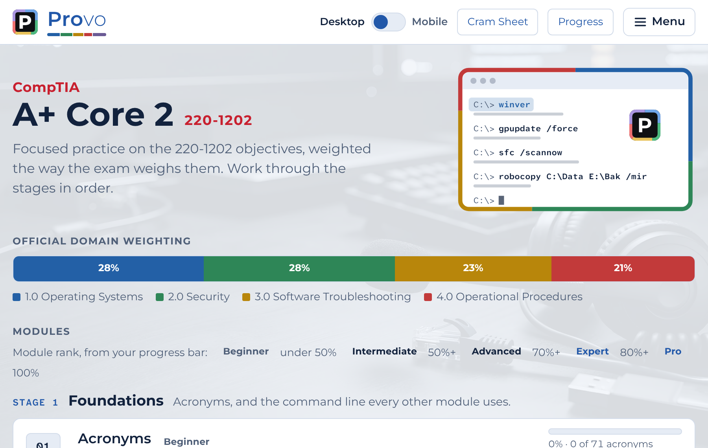

# Provo A+ Core 2

Provo's study lab for the **CompTIA A+ Core 2 (220-1202)** exam. It drills every exam domain, tracks what you have mastered, and finishes with timed mini-exams weighted to the official domains.

**Current release:** [v1.0.2](https://github.com/benmhsmith/Provo/releases/tag/a-plus-core-2-v1.0.2) · [All A+ Core 2 releases](https://github.com/benmhsmith/Provo/releases?q=a-plus-core-2) · [What changed](CHANGELOG.md)

A+ certification takes two exams. This tool covers **Core 2 (220-1202)**. [Core 1 (220-1201)](../a-plus-core-1/) has its own tool.

All 14 modules are open:

- **01 Acronyms:** 101 exam acronyms, asked three ways (spell it out, match the description, what it is), plus a Type it mode.
- **02 to 10, the objective modules:** 295 terms in 38 topics. Each term is asked several ways: name it, define it, and spot it in a scenario, with wrong answers chosen to be the same kind of thing as the right one. Malware and attacks also ask for the best defense. The two troubleshooting modules ask for each problem's usual fix, from its name and from a scenario.
- **11 Question Qualifiers:** 50 help desk questions, 10 each for FIRST, NEXT, BEST, MOST likely, and MINIMUM.
- **12 Exam-Style Drill:** 208 exam-style questions across all four domains and 36 skills. One question in four in modules 02 to 10 comes from this bank.
- **13 Performance-Based Questions:** seven simulations, a new variation every run: malware removal in order, the command line, Windows tools, a SOHO router audit, share and NTFS permissions, backups and restores, and a help desk queue.
- **14 Mini-Exams:** picked in proportion to the domain weights, with PBQs first. Choose 10, 20, or 40 questions, or every PBQ back to back.

Use it in your browser: https://benmhsmith.github.io/Provo/a-plus-core-2/

<p></p>

## Exam at a glance

- Up to 90 questions in 90 minutes. Multiple choice (single and multiple response), drag and drop, and performance-based questions.
- Passing score: 700 on a 100–900 scale.
- Launched March 25, 2025 (A+ V15).

| Domain | Weight |
|---|---|
| 1.0 Operating Systems | 28% |
| 2.0 Security | 28% |
| 3.0 Software Troubleshooting | 23% |
| 4.0 Operational Procedures | 21% |

## Modules

| Stage | Module | Objectives |
|---|---|---|
| 1 · Foundations | 01 Acronyms | Acronyms |
| | 02 Command Line & Scripting | 1.5, 4.8 |
| 2 · Operating systems | 03 OS Types, Installs & Windows Editions | 1.1–1.3 |
| | 04 Windows Tools, Settings & Networking | 1.4, 1.6, 1.7 |
| | 05 macOS, Linux & Applications | 1.8–1.11 |
| 3 · Security | 06 Security Measures, Malware & Social Engineering | 2.1–2.6 |
| | 07 Hardening Devices, Networks & Browsers | 2.7–2.11 |
| 4 · Troubleshooting & procedures | 08 Troubleshoot Windows & PC Security | 3.1, 3.4 |
| | 09 Troubleshoot Mobile OS & Apps | 3.2–3.3 |
| | 10 Operational Procedures | 4.1–4.7, 4.9–4.10 |
| 5 · Exam skills | 11 Question Qualifiers | All |
| | 12 Exam-Style Drill | All |
| | 13 Performance-Based Questions | All |
| 6 · Test | 14 Mini-Exams | All |

## Exam-style questions

Every question is original and written to the 220-1202 objectives, in four styles: best fit, scenario, exhibit (command output, a ticket, a settings screen), and direct. Every answer is explained, including why each wrong answer is wrong. The wrong answers are mistakes a technician might really make, written about as long as the right answer so length gives nothing away, and answer positions are shuffled every time.

## How to use it

Pick whichever fits you. Your progress is saved on your own device and never leaves it.

### Option 1: In your browser (nothing to install)

Open the web version: **https://benmhsmith.github.io/Provo/a-plus-core-2/**

Works on Windows, Mac, Linux, Chromebooks, Android, iPhone, and iPad. Progress is saved in that browser on that device, separately from Network+.

**iPhone or iPad:** open the link in Safari, tap the **Share** button, then **Add to Home Screen**. It opens like an app.

### Option 2: As a single file (works offline)

1. Open the current A+ Core 2 release (linked under **Current release** above).
2. Download `Provo-A-Plus-Core-2-vX.Y.Z.html`.
3. Double-click it to open it in your browser. No internet needed after that.

### Option 3: Inside Joplin (desktop and Android)

[Joplin](https://joplinapp.org/) is a free note-taking app. The plugin opens the lab right inside a note, and it installs beside Provo Network+.

**On a computer (Windows, Mac, Linux):**

1. Download `provo-a-plus-core-2-vX.Y.Z.jpl` from the newest **Provo A+ Core 2** release.
2. In Joplin, open the **Configuration** screen (**Tools → Options** on Windows and Linux, **Joplin → Settings** on Mac) and go to **Plugins**.
3. Click the **Plugin tools** gear button and choose **Install from file**. Pick the `.jpl` file.
4. Restart Joplin when asked. If Joplin keeps running in the system tray, quit it fully first.
5. Choose **Tools → Provo A+ Core 2 → Add Provo A+ Core 2 note**. A note named **Provo A+ Core 2** is created in the notebook you have open and opens in the full-width tool. Delete it any time; your progress is saved in Joplin and comes back when you add the note again.

**On Android:**

1. Download the `.jpl` file to your phone.
2. In Joplin, open **Configuration → Plugins**. Under **Advanced settings**, tap **Install from file** and pick the `.jpl` file.
3. Restart the app. Then type ` ```aplus2 ` on one line of a note and ` ``` ` on the next.

Joplin on iPhone and iPad only allows plugins from its recommended list, so use Option 1 there.

## Artwork and badges

- **Home page:** a Windows command prompt. Four real 220-1202 commands light up by domain: `winver` (operating systems), `gpupdate /force` (security policy), `sfc /scannow` (software troubleshooting), and `robocopy ... /mir` (backups, operational procedures). The Provo mark, or your Mastery Badge once earned, sits in the open space at the upper right.
- **Badges:** the A+ Core 2 Mastery Badge, 20 prestige badges (Command Line Cadet to Help Desk Hero) in bronze, silver, gold, and platinum, and 5 secret badges.
- **Background photo:** an AI-generated help desk close-up ([assets/background.webp](assets/background.webp)), softened and faded behind the content.

## Sources

- [CompTIA A+ Core 2 (V15) exam page](https://www.comptia.org/en-us/certifications/a/core-2-v15/): exam details, domains, and weights
- CompTIA A+ Core 2 220-1202 Exam Objectives: objectives 1.1 to 4.10

CompTIA and A+ are trademarks of CompTIA, Inc.

**No exam content.** Every Provo question is original, written from CompTIA's publicly available exam objectives. Provo does not use, buy, or accept real exam questions ("brain dumps"), and contributions are checked for this before they are added. Any resemblance to an actual exam question is unintentional. If you believe a question is too close to real exam content, [report it](https://github.com/benmhsmith/Provo/issues/new/choose) and we will review and replace it.
