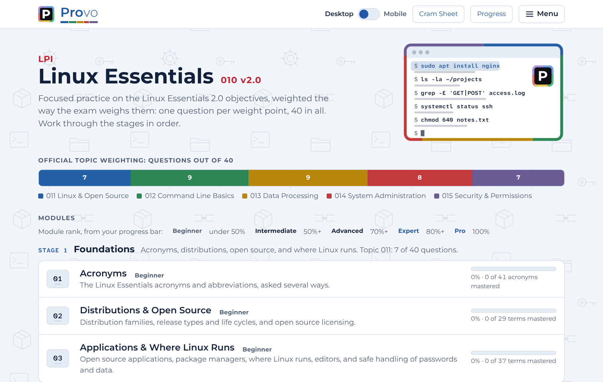

# Provo Linux Essentials

Provo's study lab for the **LPI Linux Essentials** exam (exam 010, objectives version 2.0). It drills every objective, tracks what you have mastered, gives you timed mini-exams built to LPI's blueprint, and ends with a held-out Readiness Exam.

**Current release:** [v1.0.0](https://github.com/benmhsmith/Provo/releases/tag/linux-essentials-v1.0.0) · [All Linux Essentials releases](https://github.com/benmhsmith/Provo/releases?q=linux-essentials) · [What changed](CHANGELOG.md)

All 16 modules are open:

- **01 Acronyms:** 48 acronyms and abbreviations, asked several ways, plus a Type it mode.
- **02 to 12, the objective modules:** 316 terms in 38 groups. Each term is asked several ways: name it, define it, and spot it in a scenario. Commands can also be typed from memory; where case or punctuation matters (`tar -j` and `tar -J`, `su` and `su -`), the typed answer must match exactly.
- **13 Multiple Response & Short Input:** 30 choose-two questions and 60 type-the-answer questions, the two LPI formats besides ordinary multiple choice.
- **14 Exam-Style Drill:** 205 exam-style questions across all 19 objectives, in four styles: direct, scenario, exhibit, and best fit. One question in four in modules 02 to 12 comes from this bank.
- **15 Mini-Exams:** 10, 20, or 40 questions built to LPI's blueprint (one question per objective weight point), mixing multiple choice, multiple response, and short input. Your first exam is saved as your baseline.
- **16 Readiness Exam:** 40 held-out questions that appear nowhere else in the app, in exactly the exam's proportions. Your first attempt is an honest measure of readiness.

Use it in your browser: https://benmhsmith.github.io/Provo/linux-essentials/

<p></p>

## Exam at a glance

- 40 questions in 60 minutes.
- Multiple choice, multiple response, and short input.
- Scaled score from 200 to 800; 500 passes.
- LPI gives each objective one exam question per weight point.
- Version 2.0 of the objectives was released in October 2026. Version 1.6 (010-160) remains available until it retires in April 2027.

| Topic | Questions |
|---|---|
| 011 The Linux Operating System and Open Source Software | 7 |
| 012 Command Line Basics | 9 |
| 013 Data Processing | 9 |
| 014 Linux System Administration Basics | 8 |
| 015 Security and Filesystem Permissions | 7 |

## Modules

| Stage | Module | Objectives |
|---|---|---|
| 1 · Foundations | 01 Acronyms | All |
| | 02 Distributions & Open Source | 011.1, 011.3 |
| | 03 Applications & Where Linux Runs | 011.2, 011.4 |
| 2 · The command line | 04 The Shell & Getting Help | 012.1, 012.2 |
| | 05 Files, Directories & Paths | 012.3, 012.4 |
| 3 · Data processing | 06 Archives, Redirection & Text | 013.1, 013.2 |
| | 07 Shell Scripting | 013.3 |
| 4 · System administration | 08 Installing Linux & Hardware | 014.1, 014.2 |
| | 09 Processes, Services & Logs | 014.3 |
| | 10 Network Configuration | 014.4 |
| 5 · Security & permissions | 11 Users, Groups & Remote Access | 015.1, 015.2 |
| | 12 Permissions & Special Files | 015.3, 015.4 |
| 6 · Exam skills | 13 Multiple Response & Short Input | All |
| | 14 Exam-Style Drill | All |
| 7 · Test | 15 Mini-Exams | All |
| | 16 Readiness Exam | All |

## Questions

Every question is original and written to the version 2.0 objectives. Every command, option, and output was checked on a live Ubuntu system, and the exhibits are real command output (addresses use documentation and private ranges). Every answer is explained, including why each wrong answer is wrong. The wrong answers are written about as long as the right one, so length gives nothing away, and answer positions are shuffled every time.

## Measuring readiness

1. Take one 20-question mini-exam before you study anything. It is saved as your **baseline**.
2. Study with the modules and mini-exams until your full mini-exams are steady at 80% or more.
3. Take the **Readiness Exam** once. Its questions appear nowhere else, so the first attempt measures what you know, not what you remember. Retakes are allowed but marked.
4. The Readiness Exam page shows your baseline, recent mini-exams, and first Readiness Exam score side by side, to compare with your real result.

## How to use it

Pick whichever fits you. Your progress is saved on your own device and never leaves it.

### Option 1: In your browser (nothing to install)

Open the web version: **https://benmhsmith.github.io/Provo/linux-essentials/**

Works on Windows, Mac, Linux, Chromebooks, Android, iPhone, and iPad. Progress is saved in that browser on that device, separately from the other Provo exams.

**iPhone or iPad:** open the link in Safari, tap the **Share** button, then **Add to Home Screen**. It opens like an app.

### Option 2: As a single file (works offline)

1. Open the current Linux Essentials release (linked under **Current release** above).
2. Download `Provo-Linux-Essentials-vX.Y.Z.html`.
3. Double-click it to open it in your browser. No internet needed after that.

### Option 3: Inside Joplin (desktop and Android)

[Joplin](https://joplinapp.org/) is a free note-taking app. The plugin opens the lab right inside a note, and it installs beside the other Provo plugins.

**On a computer (Windows, Mac, Linux):**

1. Download `provo-linux-essentials-vX.Y.Z.jpl` from the newest **Provo Linux Essentials** release.
2. In Joplin, open the **Configuration** screen (**Tools → Options** on Windows and Linux, **Joplin → Settings** on Mac) and go to **Plugins**.
3. Click the **Plugin tools** gear button and choose **Install from file**. Pick the `.jpl` file.
4. Restart Joplin when asked. If Joplin keeps running in the system tray, quit it fully first.
5. Choose **Tools → Provo Linux Essentials → Add Provo Linux Essentials note**. A note named **Provo Linux Essentials** is created in the notebook you have open and opens in the full-width tool. Delete it any time; your progress is saved in Joplin and comes back when you add the note again.

**On Android:**

1. Download the `.jpl` file to your phone.
2. In Joplin, open **Configuration → Plugins**. Under **Advanced settings**, tap **Install from file** and pick the `.jpl` file.
3. Restart the app. Then type ` ```lpile ` on one line of a note and ` ``` ` on the next.

Joplin on iPhone and iPad only allows plugins from its recommended list, so use Option 1 there.

## Artwork and badges

- **Home page:** a Bash terminal. Five real Linux Essentials commands light up by topic: `sudo apt install nginx` (011), `ls -la` (012), `grep -E` (013), `systemctl status` (014), and `chmod 640` (015). Six reference images rotate in after it: reading a permission string, where things live in the file system, redirection and pipes, distribution families, tar options, and the parts of a script.
- **Badges:** the Linux Essentials Mastery Badge, 20 prestige badges (Shell Starter to Linux Pro), and 5 secret badges.
- **Background:** a faint pattern of line icons. Text only: no LPI logos are used.

## Sources

- [LPI Linux Essentials Objectives V2.0](https://wiki.lpi.org/wiki/Linux_Essentials_Objectives_V2.0): topics, objectives, weights, and commands
- [LPI exam FAQ](https://www.lpi.org/our-certifications/faq/): scoring, question count, and one question per weight point
- [LPI Linux Essentials](https://www.lpi.org/our-certifications/linux-essentials/)

Linux Professional Institute, LPI, and Linux Essentials are trademarks of Linux Professional Institute Inc. Linux is a registered trademark of Linus Torvalds. Provo is independent and is not affiliated with or endorsed by LPI.

**No exam content.** Every Provo question is original, written from LPI's publicly available exam objectives. Provo does not use, buy, or accept real exam questions ("brain dumps"), and contributions are checked for this before they are added. Any resemblance to an actual exam question is unintentional. If you believe a question is too close to real exam content, [report it](https://github.com/benmhsmith/Provo/issues/new/choose) and we will review and replace it.
